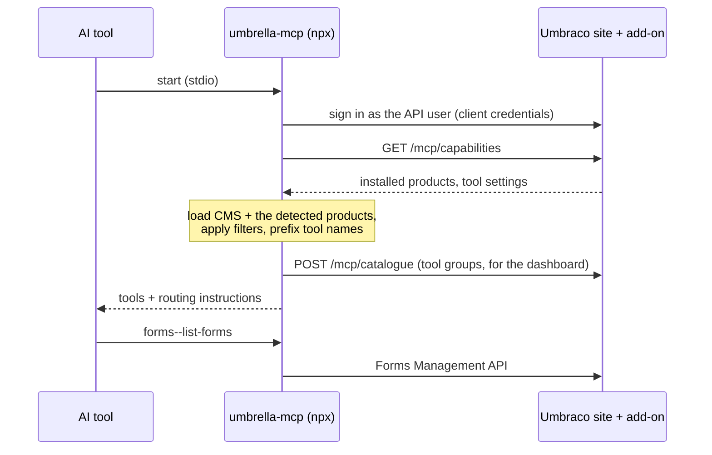

# Umbrella

One MCP server for your Umbraco 17 site. Umbrella detects which Umbraco products the site has installed and gives your AI tool (Claude Code, VS Code, Cursor, Claude Desktop) the tools for exactly those products.

| Package | Where it runs | What it does |
|---|---|---|
| [`Umbraco.Community.Umbrella`](https://www.nuget.org/packages/Umbraco.Community.Umbrella) (NuGet) | In your Umbraco site | Detects installed products, serves `GET /umbraco/management/api/v1/mcp/capabilities`, adds **MCP** health checks and the **Umbrella** dashboard, and writes a ready-to-use `.mcp.json` in Development |
| [`umbrella-mcp`](https://www.npmjs.com/package/umbrella-mcp) (npm) | On your machine, started by your AI tool | Stdio MCP server: CMS tools always, Forms, Automate and Engage tools when the site has them. Tools are prefixed `cms--`, `forms--`, `automate--`, `engage--`; `get-mcp-health` explains what loaded and why |

You only install the NuGet package. Your AI tool starts `umbrella-mcp` with `npx`, which downloads it the first time.

## Contents

- [How it works](#how-it-works)
- [Get started](#get-started)
- [Configuration](#configuration)
- [Turning tool groups off](#turning-tool-groups-off)
- [Health checks](#health-checks)
- [Troubleshooting](#troubleshooting)
- [Compatibility](#compatibility)
- [Known limitations](#known-limitations)
- [Develop](#develop)

## How it works



1. The add-on finds each product by its assembly and checks that its Management API is live.
2. When your AI tool starts `umbrella-mcp`, the server signs in as an Umbraco API user and asks the site which products it has.
3. It loads the CMS tools, plus the tools of every detected product, and prefixes each tool with its product (`forms--list-forms`).
4. The server's MCP `instructions` tell the agent which prefix to use for which kind of request, and every tool description starts with its product, for example `[Umbraco Forms] …`.

Without the add-on, the server still starts, with CMS tools only. Details for contributors: [docs/architecture.md](docs/architecture.md).

## Get started

You need Umbraco 17, and Node.js 22 or later on the machine that runs your AI tool.

1. **Install the add-on** in your site and restart it:

   ```bash
   dotnet add package Umbraco.Community.Umbrella
   ```

2. **Create an API user** in the backoffice (Users → Create → API user) and add client credentials with the client id `umbraco-back-office-mcp` and a secret of your choice. Keep a copy of the secret: Umbraco stores only its hash. Give the user's groups access to the sections of the products you want the AI to use (Content, Media, Settings, Forms, Automate, Engage, …). If you choose a different client id, set `Umbraco:Mcp:ClientId` to it (see [Configuration](#configuration)).

3. **Set the secret** as an environment variable on your machine.

   macOS / Linux (add it to your shell profile to keep it):

   ```bash
   export UMBRELLA_CLIENT_SECRET="<the client secret>"
   ```

   Windows (PowerShell; applies to programs you start afterwards):

   ```powershell
   setx UMBRELLA_CLIENT_SECRET "<the client secret>"
   ```

   Restart your AI tool afterwards: it only sees variables that were set before it started.

4. **Open the site's folder in your AI tool.** When the site runs in Development, the add-on writes a `.mcp.json` next to it, filled in with the site's HTTPS address and the API user's client id. Claude Code and VS Code read this file. Approve the `umbraco` server when your tool asks, and `npx` downloads and starts `umbrella-mcp`. In the backoffice, Settings → **Umbrella** → **Overview** shows the status of this setup, and can write the file for you.

5. **Check it works.** Ask the AI to call `get-mcp-health`. It lists each product, whether its tools loaded, and how many. In the backoffice, Settings → **Umbrella** → **Overview** shows the API user the server connected as, whether it can reach each product, and what to fix if not.

### Other AI tools, or a site that is not running locally

Settings → **Umbrella** → **Overview** has config to copy for Claude Code (`.mcp.json` or a `claude mcp add` command), VS Code, Cursor and other clients, filled in with the site's URL. Replace the secret placeholder with your client secret. The generic config looks like this:

```json
{
  "mcpServers": {
    "umbraco": {
      "command": "npx",
      "args": ["-y", "umbrella-mcp@17.0.0-alpha.2"],
      "env": {
        "UMBRACO_BASE_URL": "https://your-site",
        "UMBRACO_CLIENT_ID": "umbraco-back-office-mcp",
        "UMBRACO_CLIENT_SECRET": "<your client secret>"
      }
    }
  }
}
```

The config pins `umbrella-mcp` to the add-on's version: the two packages are released together with the same version number.

This config contains the secret itself, so keep it out of source control. `UMBRACO_BASE_URL` must be `https://`: the Management API token endpoint rejects plain HTTP.

## Configuration

### Site (`appsettings.json`)

| Setting | Default | Meaning |
|---|---|---|
| `Umbraco:Mcp:ClientId` | `umbraco-back-office-mcp` | The client id put in the written `.mcp.json` and in the "MCP client setup" config. The "MCP API user" check does not use it: it reports on whichever API user the MCP server connected as |
| `Umbraco:Mcp:McpJson:Enabled` | `true` | Set to `false` to never write `.mcp.json` |
| `Umbraco:Mcp:McpJson:Path` | the site's content root | Folder to write `.mcp.json` to, relative to the content root (or absolute). Use `..` if you open the solution folder in your AI tool. The folder must exist: it is never created |
| `Umbraco:Mcp:McpJson:Command`, `Umbraco:Mcp:McpJson:Args` | `npx`, `["-y", "umbrella-mcp@<version>"]` | Override how the server is started, for example to run a local build |

For example, to write `.mcp.json` to the solution folder one level up:

```json
{
  "Umbraco": {
    "Mcp": {
      "McpJson": { "Path": ".." }
    }
  }
}
```

About the written `.mcp.json`:
- It is only written when the site runs in **Development**, once it has started, and **never overwrites a file you edited**. The file pins `umbrella-mcp` to the add-on's version, so after you upgrade the add-on the site updates that version in a file it wrote and nobody changed. If you edited the file, change the version yourself, or delete the file to have it written again.
- It contains no secret. It reads `${UMBRELLA_CLIENT_SECRET}` from your environment (Claude Code expands `${VAR}` in `.mcp.json`), so it is safe to commit.
- It needs an HTTPS address, because the Management API token endpoint rejects plain HTTP. It uses the site's first HTTPS address; if the site only listens on HTTP, nothing is written.
- For a site on `localhost` it sets `NODE_TLS_REJECT_UNAUTHORIZED=0`, because Node does not trust the ASP.NET Core development certificate. This turns off certificate checks for the MCP server process only, and only when the site is on the local machine.

### MCP server (environment variables)

| Variable | Meaning |
|---|---|
| `UMBRACO_BASE_URL`, `UMBRACO_CLIENT_ID`, `UMBRACO_CLIENT_SECRET` | The site (`https://`) and the API user to sign in as. Required: the server exits without them |
| `UMBRACO_MCP_MODULES` | Force modules on without detection, for example `forms,automate` |
| `UMBRACO_TOOL_MODES`, `UMBRACO_INCLUDE_/EXCLUDE_TOOL_COLLECTIONS`, `UMBRACO_INCLUDE_/EXCLUDE_TOOLS` | Toolkit filters. Unprefixed entries apply to CMS; `forms:<value>` targets a module; `forms:*` means no restriction for that module. In the two `*_TOOLS` lists you can also use the visible name, for example `cms--delete-document` or `forms--list-forms`. Collection filters set here for a product override the Umbrella dashboard and the [off-by-default groups](#turning-tool-groups-off) for that product |
| `UMBRACO_READONLY` | `true` registers only read-only tools, for every module. To do this for one product, use the Umbrella dashboard |
| `UMBRACO_INCLUDE_SLICES`, `UMBRACO_EXCLUDE_SLICES` | Apply to every module |

Filters match the products' own tool names, before the prefix is added. For example, to keep only the CMS `document` and `media` tool groups and every Forms tool except deleting forms:

```json
"env": {
  "UMBRACO_INCLUDE_TOOL_COLLECTIONS": "document,media",
  "UMBRACO_EXCLUDE_TOOLS": "forms--delete-form"
}
```

The command `npx -y umbrella-mcp@<version> --list-tools`, run with the same environment variables, prints the tool names the server would register and exits.

## Turning tool groups off

Settings → **Umbrella** → **Tool groups** lists every product the MCP server loaded, with one checkbox per tool group (for example Umbraco Forms → `prevalue-source`). Untick a group and save to stop exposing its tools. Fewer tools means less context for the AI and better tool choice.

Each product also has a **Read-only tools only** toggle. With it on, the product registers only tools marked read-only (the ones that list and fetch), so the AI can look at that product but not change it. The group labels then show how many tools stay, for example `form (6 of 14)`. Group checkboxes still apply on top of it.

- **Off by default:** some groups start unticked, 18 tools in all:
  - Umbraco CMS `manifest`, `user-data` and `imaging`: backoffice extension manifests, the backoffice's per-user settings store and image resize URLs.
  - Umbraco Forms `umbraco-server` and `acceptance-tests`, and Umbraco Automate `umbraco-server`: `get-server-info` twice, which `cms--get-server-information` covers, and a test aid.
  - Umbraco Forms `licensing`, `updates` and `media`: the license status, the update check and a media lookup by path.
  - Umbraco Engage `package`, `add-ons` and `cultures`: license info, whether the Forms and Commerce integrations are on, and the tracked cultures.

  Tick them to switch them on. Once you save a product, the saved list is used from then on.
- **When it applies:** the next time the MCP server starts. Reconnect it in your AI tool after saving.
- **Before the first start:** the dashboard is empty until the MCP server has connected once, because the server reports its tool groups when it starts.
- **Environment wins for groups:** if the MCP server's environment sets `UMBRACO_INCLUDE_TOOL_COLLECTIONS` or `UMBRACO_EXCLUDE_TOOL_COLLECTIONS` for a product (including `forms:*`, or an unprefixed entry for CMS), the group settings and the off-by-default groups are ignored for that product and the dashboard shows a warning. So `forms:*` brings the default-off Forms groups back, and so does any other Forms collection filter, such as `forms:folder`. `UMBRACO_INCLUDE_TOOLS` also still includes a tool from a switched-off group.
- **Read-only always applies:** it only removes tools, so the environment can't turn it off. `UMBRACO_READONLY=true` makes every product read-only whatever the dashboard says.
- **Not a security control:** anyone with the API user's credentials can call the Management API directly. Use the API user's groups and sections to limit what it can do.

The settings and the reported tool groups are stored in the `umbracoKeyValue` table, so they survive restarts and are shared by every server of a load-balanced site. Changing them needs access to the Settings section.

## Health checks

Settings → Health Check → **MCP** has three checks:

- **MCP products**: which Umbraco products the add-on detected, their versions, and whether their Management APIs are available.
- **MCP API user**: every API user the MCP server has connected as, whatever its name or client id: when it last connected, whether it can still sign in, and whether it has the sections for each detected product. The MCP server connects once when your AI tool starts it, so until then the check only says no MCP server has connected yet. A stdio MCP server has no lasting connection, so the check shows the last connection, not whether one is open right now. Connections are stored in the `umbracoKeyValue` table.
- **MCP client setup**: whether the MCP server that last started is the add-on's version.

The checks show short rows with the same findings as Settings → Umbrella → Overview, which has the details and the config to copy.

In your AI tool, the `get-mcp-health` tool shows what the server loaded and why: the add-on's status, the Umbraco version check, each product with its tool count and issues, and notes on what to fix, including when the server is not the add-on's version.

## Troubleshooting

Start with `get-mcp-health` in your AI tool and the **MCP** health checks in the backoffice. They cover most of the cases below.

| Symptom | Likely cause | Fix |
|---|---|---|
| The server exits with `Could not authenticate against Umbraco` | Wrong URL, client id or secret; the API user is disabled; or `UMBRACO_BASE_URL` is `http://` | Check the three `UMBRACO_*` values. The URL must be `https://`. The "MCP API user" check shows whether the user can still sign in |
| Authentication fails although the secret is right | `UMBRELLA_CLIENT_SECRET` was not set when your AI tool started, so the server received the literal text `${UMBRELLA_CLIENT_SECRET}` | Set the variable, then restart the AI tool (not just the MCP server) |
| The server exits with `Error: UMBRACO_BASE_URL is required.` (or another variable) | The MCP client config has no `env` entry for it | Use the config from Settings → Umbrella → Overview, or let the site write `.mcp.json` |
| TLS errors such as `self-signed certificate` | Node does not trust the site's certificate. `.mcp.json` only turns checks off for `localhost` | Trust the certificate with `NODE_EXTRA_CA_CERTS=<path to the .pem>`, or for a local development host only, add `NODE_TLS_REJECT_UNAUTHORIZED=0` to `env` |
| Only `cms--` tools are listed | The add-on is not installed or not reachable, or a product is not installed, not enabled, or not on major version 17 | `get-mcp-health` gives the reason per product. "MCP products" in the backoffice shows what the site detected |
| A product's tools return permission errors | The API user's groups don't grant that product's section | The "MCP API user" check names the missing section |
| No `.mcp.json` was written | The site is not running in Development, the file already exists, the site has no HTTPS address, `Umbraco:Mcp:McpJson:Enabled` is `false`, or the `Path` folder doesn't exist | The site log says why when there is no HTTPS address. Or copy the config from Settings → Umbrella → Overview |
| "MCP client setup", the dashboard or `get-mcp-health` says the versions differ | Your AI tool's config still pins the `umbrella-mcp` of an earlier add-on | Set `umbrella-mcp@<add-on version>` in the config. A `.mcp.json` the site wrote and nobody edited is updated the next time the site starts in Development |
| The Umbrella dashboard is empty | The MCP server has not started against this site yet | Start it once from your AI tool, then reload the dashboard. If it stays empty, `get-mcp-health` notes why the tool groups could not be reported |
| Dashboard changes have no effect | The server reads the settings when it starts, or the environment sets collection filters for that product | Reconnect the MCP server. The dashboard warns when the environment overrides it |

## Compatibility

| Component | Version |
|---|---|
| Umbraco CMS | 17.x (.NET 10) |
| Node.js | 22 or later |
| Umbraco Forms, Umbraco Automate, Umbraco Engage | 17.x |
| `@umbraco-cms/mcp-server-sdk` | 1.0.0-beta.45 (one copy shared by all products) |
| `@umbraco-cms/mcp-dev` | 17.6.10 |
| `@umbraco-forms/mcp-dev` | 17.6.1-beta.4 |
| `@umbraco-automate/mcp-dev` | 17.4.0-beta.2 |
| `@umbraco-engage/mcp-dev` | 17.0.0-beta.3 |

## Known limitations

- Tool names are prefixed (`cms--get-document`), so they differ from the standalone CMS MCP's names.
- `@umbraco-cms/mcp-dev/collections` does not export the CMS server's runtime setup (`setUmbracoVersion`, `setAllowFilePathUploads`). Version-gated CMS tools (for example `create-and-publish-document`, `update-and-publish-document`, `sort-document-children`, `sort-document-root-children`) are not registered, document/data type schema tools use their fallback path, and media tools do not accept local file paths. Fixing this needs the CMS package to export a setup hook from `./collections`.
- Only `--list-tools` is supported as a CLI flag; `--describe-tool` is not implemented.
- Collection filters do not pull in dependent collections (for example `media` does not add `temporary-file`) the way the standalone CMS MCP does.

## Develop

The repository has the add-on in `src/Umbraco.Mcp`, the server in `npm/`, and a demo site with Forms, Automate and Engage in `demo-site/`.

```bash
dotnet test Umbraco.Mcp.slnx
cd npm && npm install && npm test && npm run build
```

Setup from scratch, the demo site, and the end-to-end checks: [docs/development.md](docs/development.md).

- How it works inside: [docs/architecture.md](docs/architecture.md)
- Before merging: [docs/merging.md](docs/merging.md) (CI checks, guards, PR checklist)
- Releasing: [docs/releasing.md](docs/releasing.md)
- Adding a product: [docs/adding-a-product.md](docs/adding-a-product.md)

## License

[MIT](LICENSE)
