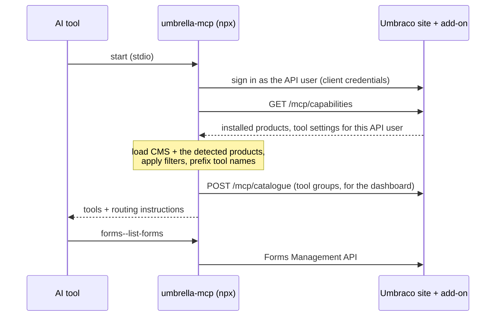

Nuget: https://www.nuget.org/packages/Umbraco.Community.Umbrella/

# Umbrella

One MCP server for your Umbraco 17 site. Umbrella detects which Umbraco products the site has installed and gives your AI tool (Claude Code, VS Code, Cursor, Claude Desktop) the tools for exactly those products.

| Package | Where it runs | What it does |
|---|---|---|
| [`Umbraco.Community.Umbrella`](https://www.nuget.org/packages/Umbraco.Community.Umbrella) (NuGet) | In your Umbraco site | Detects installed products, serves `GET /umbraco/management/api/v1/mcp/capabilities`, adds **MCP** health checks, and the **Umbrella** dashboard with the config for each AI tool |
| [`umbrella-mcp`](https://www.npmjs.com/package/umbrella-mcp) (npm) | On your machine, started by your AI tool | Stdio MCP server: CMS tools always, Forms, Automate and Engage tools when the site has them. Tools are prefixed `cms--`, `forms--`, `automate--`, `engage--`; `get-mcp-health` explains what loaded and why |

You only install the NuGet package. Your AI tool starts `umbrella-mcp` with `npx`, which downloads it the first time.

## Contents

- [How it works](#how-it-works)
- [Get started](#get-started)
- [Teams, editors and hosted sites](#teams-editors-and-hosted-sites)
- [Configuration](#configuration)
- [Turning tool groups off](#turning-tool-groups-off)
- [Health checks](#health-checks)
- [Troubleshooting](#troubleshooting)
- [Compatibility](#compatibility)
- [Known limitations](#known-limitations)
- [Develop](#develop)

## How it works



1. The add-on finds each product by its assembly and checks that its Management API is live.
2. When your AI tool starts `umbrella-mcp`, the server signs in as an Umbraco API user and asks the site which products it has.
3. It loads the CMS tools, plus the tools of every detected product, and prefixes each tool with its product (`forms--list-forms`).
4. The server's MCP `instructions` tell the agent which prefix to use for which kind of request, and every tool description starts with its product, for example `[Umbraco Forms] …`.

Without the add-on, the server still starts, with CMS tools only. Details for contributors: [docs/architecture.md](docs/architecture.md).

## Get started

You need Umbraco 17, and Node.js 22 or later on the machine that runs your AI tool.

1. **Install the add-on** in your site and restart it:

   ```bash
   dotnet add package Umbraco.Community.Umbrella
   ```

2. **Create an API user** in the backoffice (Users → Create → API user) and add client credentials with a client id and a secret of your choice, for example `umbraco-back-office-mcp`. Keep a copy of the secret: Umbraco stores only its hash. Give the user's groups access to the sections of the products you want the AI to use (Content, Media, Settings, Forms, Automate, Engage, …). Each person who uses an AI tool with the site gets an API user of their own: see [Teams, editors and hosted sites](#teams-editors-and-hosted-sites).

3. **Copy the config for your AI tool.** In the backoffice, open Settings → **Umbrella** → **Overview** → **Connect an AI tool**, expand **Set up an MCP client for this site**, pick the API user to sign in as, and pick your tool:

   | Tab | Where it goes |
   |---|---|
   | Claude Code | `.mcp.json` in the folder you open in Claude Code |
   | Claude Code (command) | a `claude mcp add` command to run in that folder; Claude Code keeps it in your own settings |
   | Claude Desktop | `claude_desktop_config.json` (Claude Desktop: Settings → Developer → Edit Config) |
   | VS Code | `.vscode/mcp.json` |
   | Cursor | `.cursor/mcp.json` |
   | Other clients | the generic `mcpServers` config |

   The config is filled in with the address you opened the backoffice on and the API user's client id.

4. **Supply the secret.** The config never contains the secret, only a way to supply it:
   - **VS Code** asks for it when the server starts.
   - **Claude Code (`.mcp.json`) and Cursor** read it from the `UMBRELLA_CLIENT_SECRET` environment variable.
   - **The `claude mcp add` command, Claude Desktop and other clients** have a placeholder: replace it with the secret. That config then contains the secret, so keep it out of source control.

   To set the environment variable on macOS / Linux (add it to your shell profile to keep it):

   ```bash
   export UMBRELLA_CLIENT_SECRET="<the client secret>"
   ```

   Windows (PowerShell; applies to programs you start afterwards):

   ```powershell
   setx UMBRELLA_CLIENT_SECRET "<the client secret>"
   ```

   Restart your AI tool afterwards: it only sees variables that were set before it started.

5. **Start it.** Restart or reload your AI tool and approve the `umbraco` server when it asks. `npx` downloads and starts `umbrella-mcp`.

6. **Check it works.** Ask the AI to call `get-mcp-health`. It lists each product, whether its tools loaded, and how many. In the backoffice, Settings → **Umbrella** → **Overview** shows the API user the server connected as, whether it can reach each product, and what to fix if not.

### The config

Every tab on the Overview is a variant of this config:

```json
{
  "mcpServers": {
    "umbraco": {
      "command": "npx",
      "args": ["-y", "umbrella-mcp@17.0.0-alpha.4"],
      "env": {
        "UMBRACO_BASE_URL": "https://your-site",
        "UMBRACO_CLIENT_ID": "umbraco-back-office-mcp",
        "UMBRACO_CLIENT_SECRET": "<your client secret>"
      }
    }
  }
}
```

- **Version:** the config pins `umbrella-mcp` to the add-on's version: the two packages are released together with the same version number. After upgrading the add-on, change the version in your config; the Overview, the "MCP client setup" check and `get-mcp-health` say when they differ.
- **HTTPS:** `UMBRACO_BASE_URL` must be `https://`, because the Management API token endpoint rejects plain HTTP. Open the backoffice over HTTPS to get the right address in the config.
- **Local sites:** for a site on `localhost` the config sets `NODE_TLS_REJECT_UNAUTHORIZED=0`, because Node does not trust the ASP.NET Core development certificate. This turns off certificate checks for the MCP server process only, and only when the site is on the local machine.

## Teams, editors and hosted sites

Give each person who connects an AI tool their own API user:

- **Why one each:** the Overview's **MCP Users** table shows each API user that connected, and [Tool Permissions](#different-settings-per-api-user) can give each one their own settings. People who share an API user share its settings and show up as one user.
- **Setting someone up:** create their API user with its own client id, and give its groups the sections they need. On Settings → **Umbrella** → **Overview** → **Connect an AI tool**, expand **Set up an MCP client for this site**, pick that user, copy the config for their AI tool, and send it to them. Send the client secret separately.
- **Editors:** an editor doesn't need the site's source code. They need Node.js 22 or later and an AI tool, for example Claude Desktop. The Umbrella dashboard is in the Settings section, so someone with access to it sets them up.
- **Hosted sites, such as Umbraco Cloud:** the MCP server runs on each person's machine and connects to the site over HTTPS, so it works with any environment. Open the dashboard on the environment the AI tools should use, so the config gets its address. Tool settings and the connection list are stored in that environment's database, so each environment has its own; create the API users on the environment the AI tools connect to.
- **Shared repositories:** a `.mcp.json` committed to a repository holds one client id, so everyone who uses it signs in as the same API user. Use the `claude mcp add` command instead, which Claude Code keeps in each person's own settings, or keep `.mcp.json` out of the repository.

Tool settings are guardrails, not access control: see [Known limitations](#known-limitations).

## Configuration

### Site (`appsettings.json`)

| Setting | Default | Meaning |
|---|---|---|
| `Umbraco:Mcp:ClientId` | `umbraco-back-office-mcp` | The client id the config on Settings → Umbrella → Overview starts with when no API user is picked yet. The "MCP API user" check does not use it: it reports on whichever API user the MCP server connected as |

### MCP server (environment variables)

| Variable | Meaning |
|---|---|
| `UMBRACO_BASE_URL`, `UMBRACO_CLIENT_ID`, `UMBRACO_CLIENT_SECRET` | The site (`https://`) and the API user to sign in as. Required: the server exits without them |
| `UMBRACO_MCP_MODULES` | Force modules on without detection, for example `forms,automate` |
| `UMBRACO_TOOL_MODES`, `UMBRACO_INCLUDE_/EXCLUDE_TOOL_COLLECTIONS`, `UMBRACO_INCLUDE_/EXCLUDE_TOOLS` | Toolkit filters. Unprefixed entries apply to CMS; `forms:<value>` targets a module; `forms:*` means no restriction for that module. In the two `*_TOOLS` lists you can also use the visible name, for example `cms--delete-document` or `forms--list-forms`. Collection filters set here for a product override the Umbrella dashboard and the [off-by-default groups](#turning-tool-groups-off) for that product |
| `UMBRACO_READONLY` | `true` registers only read-only tools, for every module. To do this for one product, use the Umbrella dashboard |
| `UMBRACO_NO_DESTRUCTIVE` | `true` leaves out the destructive tools, for every module. To do this for one product, use the Umbrella dashboard |
| `UMBRACO_INCLUDE_SLICES`, `UMBRACO_EXCLUDE_SLICES` | Apply to every module |

Filters match the products' own tool names, before the prefix is added. For example, to keep only the CMS `document` and `media` tool groups, and the Forms tools (as set on the dashboard) except deleting forms:

```json
"env": {
  "UMBRACO_INCLUDE_TOOL_COLLECTIONS": "document,media",
  "UMBRACO_EXCLUDE_TOOLS": "forms--delete-form"
}
```

The command `npx -y umbrella-mcp@<version> --list-tools`, run with the same environment variables, prints the tool names the server would register and exits.

## Turning tool groups off

Settings → **Umbrella** → **Tool Permissions** lists each product the site has installed (and any the MCP server reported), with one checkbox per tool group (for example Umbraco Forms → `prevalue-source`). Untick a group and save to stop exposing its tools. Fewer tools means less context for the AI and better tool choice.

Each product also has a tool level, with three choices:

- **Full access:** every tool, the default.
- **No destructive tools:** leaves out the tools the product marks as destructive (`destructiveHint`), so the AI can create and edit but not delete. That is mostly deletes, emptying recycle bins and terminating runs, plus removing and disconnecting Automate steps, Automate version rollback, running a Forms record action, and a few Engage switches and permission changes. Unpublishing, moving to the recycle bin, and CMS and Forms version rollback are not flagged, so they stay available.
- **Read-only:** only tools marked read-only (the ones that list and fetch), so the AI can look at that product but not change it.

The group labels show how many tools stay at the chosen level, for example `form (6 of 14)`. Group checkboxes still apply on top of it.

- **Off by default:** some groups start unticked, 18 tools in all:
  - Umbraco CMS `manifest`, `user-data` and `imaging`: backoffice extension manifests, the backoffice's per-user settings store and image resize URLs.
  - Umbraco Forms `umbraco-server` and `acceptance-tests`, and Umbraco Automate `umbraco-server`: `get-server-info` twice, which `cms--get-server-information` covers, and a test aid.
  - Umbraco Forms `licensing`, `updates` and `media`: the license status, the update check and a media lookup by path.
  - Umbraco Engage `package`, `add-ons` and `cultures`: license info, whether the Forms and Commerce integrations are on, and the tracked cultures.

  Tick them to switch them on. Once you save a product, the saved list is used from then on.
- **When it applies:** the next time the MCP server starts. Reconnect it in your AI tool after saving.
- **Before the first start:** Tool Permissions has no tool groups until an MCP server has started once, because the server reports its tool groups when it starts.
- **Environment wins for groups:** if the MCP server's environment sets `UMBRACO_INCLUDE_TOOL_COLLECTIONS` or `UMBRACO_EXCLUDE_TOOL_COLLECTIONS` for a product (including `forms:*`, or an unprefixed entry for CMS), the group settings and the off-by-default groups are ignored for that product and the dashboard shows a warning. So `forms:*` brings the default-off Forms groups back, and so does an exclude filter such as `UMBRACO_EXCLUDE_TOOL_COLLECTIONS=forms:folder`. An include filter such as `forms:folder` keeps only the groups it names. `UMBRACO_INCLUDE_TOOLS` also still includes a tool from a switched-off group.
- **The level always applies:** it only removes tools, so the environment can't turn it off, and it applies even when environment collection filters make the group settings ignored. `UMBRACO_READONLY=true` makes every product read-only and `UMBRACO_NO_DESTRUCTIVE=true` removes destructive tools from every product, whatever the dashboard says.
- **If the site can't be read:** when the MCP server can't read the site's settings it can't apply the dashboard level, so set `UMBRACO_NO_DESTRUCTIVE=true` (or `UMBRACO_READONLY=true`) in the AI tool's config to enforce it regardless.
- **Older servers:** an MCP server from before the No destructive level ignores it. When the last report has no counts for that level, the product warns that the MCP server still includes destructive tools.
- **Not a security control:** anyone with the API user's credentials can call the Management API directly. Use the API user's groups and sections to limit what it can do.

The settings and the reported tool groups are stored in the `umbracoKeyValue` table, so they survive restarts and are shared by every server of a load-balanced site. Changing them needs access to the Settings section.

### Different settings per API user

When each developer has their own API user, the tool settings can differ per user. Above the products, the **API user** picker starts on **All API users (defaults)**: the settings you see and save there are the defaults every API user follows. Pick one API user to give it its own settings.

- **Use defaults:** for a single API user, each product has a **Use defaults** switch, on until you change it. On, the product shows the defaults and the user follows them, also when you change the defaults later. Off, you edit that product's groups and level for this user only, starting from a copy of the current defaults. Saving stores the products with the switch off as that user's own settings; products with it on keep following the defaults.
- **Per product, all or nothing:** an own setting holds a product's groups and level together. A user can't follow the default groups with its own level.
- **Any API user:** every API user on the site can be picked, also one that has never connected, so you can set up a new developer before their first start. Under a default, the dashboard names the users that have their own settings for that product.
- **When it applies:** the next time that user's MCP server starts, so they reconnect it in their AI tool. `get-mcp-health` says when the settings are the user's own ("as set in the backoffice for this API user").
- **Counts:** for a single API user, the tool counts come from that user's own last start. A user whose MCP server hasn't started yet shows its groups and levels without counts until it has, because the counts depend on each API user's permissions (the CMS tools in particular). Under **All API users (defaults)**, each group shows the highest count any API user's MCP server reported.
- **Overview:** the **MCP Users** table on Settings → Umbrella → **Overview** shows, per connected API user, when it last connected, which products it can reach, and under **Tools** its level per product (own settings or defaults) with the number of tools its last start got with those settings. **Edit permissions** opens Tool Permissions with that user picked. An `umbrella-mcp` version mismatch is a warning per user at the top of the Overview, which only shows when something needs attention.

## Health checks

Settings → Health Check → **MCP** has three checks:

- **MCP products**: which Umbraco products the add-on detected, their versions, and whether their Management APIs are available.
- **MCP API user**: every API user the MCP server has connected as, whatever its name or client id: when it last connected, whether it can still sign in, and whether it has the sections for each detected product. The MCP server connects once when your AI tool starts it, so until then the check only says no MCP server has connected yet. A stdio MCP server has no lasting connection, so the check shows the last connection, not whether one is open right now. Connections are stored in the `umbracoKeyValue` table.
- **MCP client setup**: whether each connected API user's MCP server is the add-on's version.

The checks show short rows with the same findings as Settings → Umbrella → Overview, which has the details and the config to copy. The "MCP client setup" description points there, once for the whole group.

In your AI tool, the `get-mcp-health` tool shows what the server loaded and why: the add-on's status, the Umbraco version check, each product with its tool count and issues, and notes on what to fix, including when the server is not the add-on's version.

## Troubleshooting

Start with `get-mcp-health` in your AI tool and the **MCP** health checks in the backoffice. They cover most of the cases below.

| Symptom | Likely cause | Fix |
|---|---|---|
| The server exits with `Could not authenticate against Umbraco` | Wrong URL, client id or secret; the API user is disabled; or `UMBRACO_BASE_URL` is `http://` | Check the three `UMBRACO_*` values. The URL must be `https://`. The "MCP API user" check shows whether the user can still sign in |
| Authentication fails although the secret is right, or the server exits with `Error: UMBRACO_CLIENT_SECRET is required.` | `UMBRELLA_CLIENT_SECRET` was not set when your AI tool started, so the server received the literal text `${UMBRELLA_CLIENT_SECRET}`, or nothing | Set the variable, then restart the AI tool (not just the MCP server) |
| The Overview's config has the wrong client id | The API user picker is on another user, or no API user has a client id yet | Pick the API user under **Connect an AI tool**. Only API users with client credentials are listed |
| The server exits with `Error: UMBRACO_BASE_URL is required.` (or another variable) | The MCP client config has no `env` entry for it | Use the config from Settings → Umbrella → Overview |
| TLS errors such as `self-signed certificate` | Node does not trust the site's certificate. The config from the Overview only turns checks off for `localhost` | Trust the certificate with `NODE_EXTRA_CA_CERTS=<path to the .pem>`, or for a local development host only, add `NODE_TLS_REJECT_UNAUTHORIZED=0` to `env` |
| Only `cms--` tools are listed | The add-on is not installed or not reachable, or a product is not installed, not enabled, or not on major version 17 | `get-mcp-health` gives the reason per product. "MCP products" in the backoffice shows what the site detected |
| A product's tools return permission errors | The API user's groups don't grant that product's section | The "MCP API user" check names the missing section |
| "MCP client setup", the dashboard or `get-mcp-health` says the versions differ | Your AI tool's config still pins the `umbrella-mcp` of an earlier add-on | Set `umbrella-mcp@<add-on version>` in the config |
| Tool Permissions shows "No tool groups reported yet" | No MCP server has started against this site yet | Start it once from your AI tool, then reload the dashboard. If it stays empty, `get-mcp-health` notes why the tool groups could not be reported |
| Dashboard changes have no effect | The server reads the settings when it starts, or the environment sets collection filters for that product | Reconnect the MCP server. The dashboard warns when the environment overrides it |

## Compatibility

| Component | Version |
|---|---|
| Umbraco CMS | 17.x (.NET 10) |
| Node.js | 22 or later |
| Umbraco Forms, Umbraco Automate, Umbraco Engage | 17.x |
| `@umbraco-cms/mcp-server-sdk` | 1.0.0-beta.46 (one copy shared by all products) |
| `@umbraco-cms/mcp-dev` | 17.6.10 |
| `@umbraco-forms/mcp-dev` | 17.6.1-beta.5 |
| `@umbraco-automate/mcp-dev` | 17.4.0-beta.4 |
| `@umbraco-engage/mcp-dev` | 17.0.0-beta.4 |

## Known limitations

- Tool names are prefixed (`cms--get-document`), so they differ from the standalone CMS MCP's names.
- Tool settings, per API user or for everyone, are guardrails applied by the MCP server on each developer's machine, not access control. Anyone with an API user's credentials can call the Management API directly, so the API user's Umbraco permissions (groups and sections) are the boundary.
- `@umbraco-cms/mcp-dev/collections` does not export the CMS server's runtime setup (`setUmbracoVersion`, `setAllowFilePathUploads`). Version-gated CMS tools (for example `create-and-publish-document`, `update-and-publish-document`, `sort-document-children`, `sort-document-root-children`) are not registered, document/data type schema tools use their fallback path, and media tools do not accept local file paths. Fixing this needs the CMS package to export a setup hook from `./collections`.
- Only `--list-tools` is supported as a CLI flag; `--describe-tool` is not implemented.
- Collection filters do not pull in dependent collections (for example `media` does not add `temporary-file`) the way the standalone CMS MCP does.

## Develop

The repository has the add-on in `src/Umbraco.Mcp`, the server in `npm/`, and a demo site with Forms, Automate and Engage in `demo-site/`.

```bash
dotnet test Umbraco.Mcp.slnx
cd npm && npm install && npm test && npm run build
```

Setup from scratch, the demo site, and the end-to-end checks: [docs/development.md](docs/development.md).

- How it works inside: [docs/architecture.md](docs/architecture.md)
- Before merging: [docs/merging.md](docs/merging.md) (CI checks, guards, PR checklist)
- Releasing: [docs/releasing.md](docs/releasing.md)
- Adding a product: [docs/adding-a-product.md](docs/adding-a-product.md)

## License

[MIT](LICENSE)
